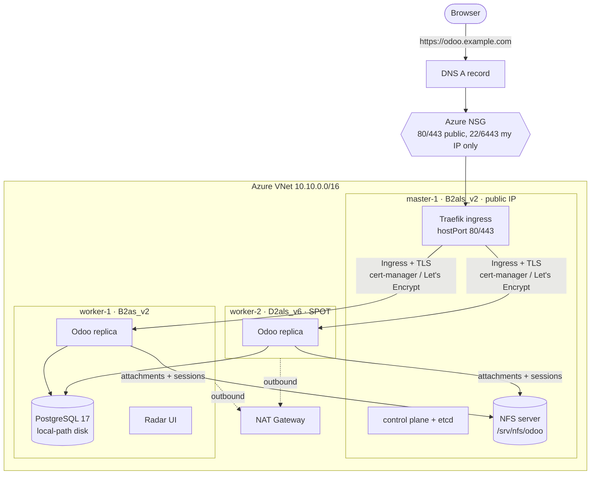

# Kubernetes on Azure with Kubespray — a hands-on HA lab

A self-built Kubernetes cluster on Azure VMs (no AKS), deployed with **Kubespray**,
running a real business application — **Odoo ERP** — with application-level high
availability, published on the internet with **automatic HTTPS**, observed with
**Radar**, and deliberately broken to see what really happens.

Built on an **Azure Free Trial** (4 vCPU quota) — every constraint and failure along
the way is documented in [lessons learned](docs/lessons-learned.md).

## Architecture



## Stack

| Layer | Choice |
|---|---|
| Cloud | Azure VMs, VNet, NSG, NAT Gateway, Spot VM (Free Trial) |
| OS | Ubuntu 24.04 LTS |
| Provisioning | Bash + Azure CLI (idempotent), ARM preflight capacity probe |
| Kubernetes | Kubespray v2.32.0 → Kubernetes v1.36, containerd, Calico (VXLAN) |
| Storage | local-path provisioner (RWO), NFS (RWX) |
| Ingress / TLS | Traefik v3 (hostPort), cert-manager v1.21, Let's Encrypt HTTP-01 |
| Observability | metrics-server, Radar (Skyhook) |
| Application | Odoo 19 + PostgreSQL 17 |

## Repository layout

```
infra/azure/            00-probe-capacity.sh  01-create-infra.sh  99-destroy.sh
kubespray/inventory/    inventory + overrides to copy into Kubespray
platform/               Helm values (Traefik, Radar), Let's Encrypt ClusterIssuers
apps/odoo/              namespace, PostgreSQL, NFS volume, init Job, Odoo, Ingress
labs/                   podinfo HA lab, Spot eviction demo, Odoo load generator
docs/                   step-by-step guides 00–07 + lessons learned
```

## Quick start

| Step | Where | Guide |
|---|---|---|
| 1. Check subscription, quotas, find a deployable region | Cloud Shell | [00](docs/00-azure-account.md) |
| 2. `HOME_IP=… bash infra/azure/01-create-infra.sh` | Cloud Shell | [01](docs/01-infrastructure.md) |
| 3. Ansible key, Kubespray v2.32.0, inventory, `cluster.yml` | master-1 | [02](docs/02-kubespray.md) |
| 4. kubectl on master and PC | master-1, PC | [02](docs/02-kubespray.md#5-kubectl) |
| 5. Radar | master-1, PC | [03](docs/03-radar.md) |
| 6. local-path + NFS | master-1 | [04](docs/04-storage.md) |
| 7. Odoo | master-1 | [05](docs/05-odoo.md) |
| 8. DNS, Traefik, cert-manager, HTTPS | Cloud Shell, master-1 | [06](docs/06-publish-https.md) |
| 9. Break things | all | [07](docs/07-experiments.md) |

Clone this repository on master-1 too — the manifests are applied from there.

Values to replace (search for them):

| Placeholder | Where | Replace with |
|---|---|---|
| `198.51.100.7` | `.env.example` | your home public IP |
| `203.0.113.10` | `kubespray/.../zz-lab.yml` | master-1 public IP |
| `odoo.example.com` | `apps/odoo/50-ingress.yaml` | your domain |

## What the experiments showed

- **Spot eviction**: node `NotReady` in ~40–60 s, pods evicted after the default 300 s
  toleration, recreated elsewhere — and they **don't move back** on their own.
- **Delete 3 of 4 Odoo replicas**: the app kept serving from one replica, users stayed
  logged in (shared sessions on NFS) — but a CPU-tight node produced an `OutOfcpu` storm.
- **Planned vs sudden**: drains and rolling updates are invisible to users; sudden node loss
  is visible until the failure is detected.
- **HA ≠ schema changes**: installing Odoo modules with several replicas needs a migration step.

Details: [docs/07-experiments.md](docs/07-experiments.md), [docs/lessons-learned.md](docs/lessons-learned.md).

## Security notes

- No secrets in this repo: kubeconfigs, SSH keys, Kubespray `artifacts/` and passwords are
  git-ignored; the DB password is generated at deploy time (`openssl rand`).
- Only ports 80/443 on master-1 are public; SSH and the Kubernetes API are restricted to your IP.
- Radar has no authentication by default — it stays ClusterIP and is reached via `kubectl port-forward`.

## Cost

About $3–4/day for the whole lab (estimate). Delete it when idle:
`bash infra/azure/99-destroy.sh` — everything can be recreated from this repository.

## Next steps

- Replicated PostgreSQL (CloudNativePG) — remove the last single point of failure
- Separate Odoo cron worker, resource right-sizing, HPA
- Prometheus for historical metrics (Radar workload metrics)
- GitOps with Argo CD
- etcd backups and cluster upgrades with `upgrade-cluster.yml`

## License

[MIT](LICENSE)
